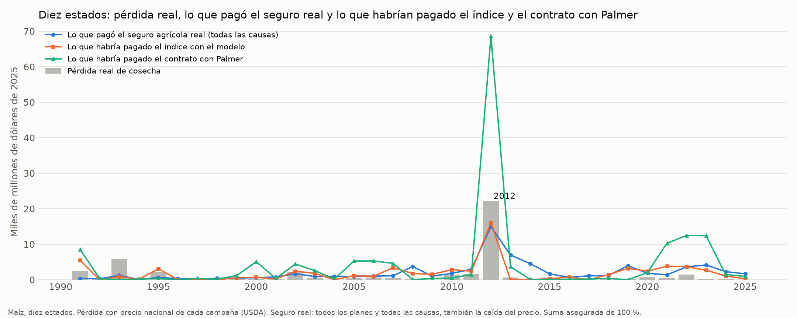
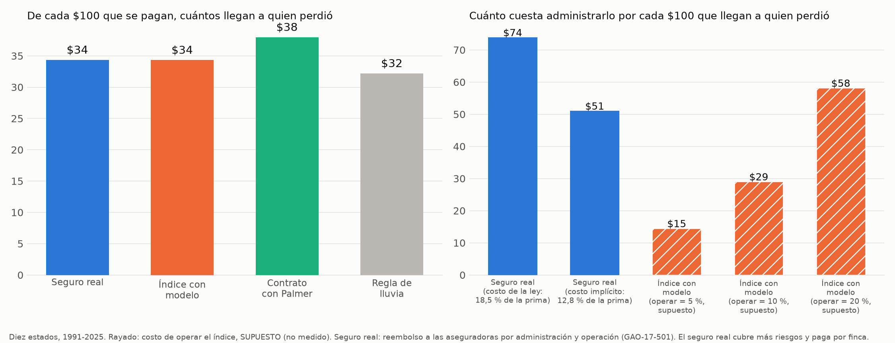

# Impacto económico del seguro de sequía para el maíz de EE. UU. (diez estados)

Script: `38_impacto_ciegas.py` (los cálculos de `31_impacto_eeuu.py`, ampliados). Plan: `docs/plan_prueba_ciegas.md`. **Todo en dólares de 2025**, deflactados con el índice de precios al consumidor urbano (CPI-U, serie CUUR0000SA0) del BLS; el promedio de 2025 usa 11 meses (octubre no tiene dato publicado). Estados: los tres originales (Iowa, Illinois, Indiana) y los siete de la prueba a ciegas (Nebraska, Minnesota, Ohio, Missouri, Kansas, South Dakota, Wisconsin). Los pagos del modelo son los de la prueba a ciegas: entrenado solo con los tres originales, año por año.

## Supuestos

| Supuesto | Valor | Fuente o razón |
|---|---|---|
| Precio del maíz | Precio nacional recibido por los agricultores, por campaña (septiembre a agosto) | USDA ERS, Feed Grains Yearbook. El precio por estado no se usó; 2025 es la cifra vigente de 2025/26 |
| Pérdida real | (esperado − observado) × área cosechada × precio, solo en condado-años con pérdida (80 % o menos del esperado) | Tendencia del condado con años anteriores |
| **Área asegurada (SUPUESTO)** | Área cosechada | El área sembrada se bajó, pero el seguro real asegura sobre otra área |
| **Suma asegurada (SUPUESTO)** | 100 % del valor esperado (75 % como sensibilidad) | Pedido del encargo |
| **Pago del modelo y de la regla "por severidad" (SUPUESTO)** | Suma × pérdida que estima el modelo, cuando se activa el corte aplicable | Igual que `31` |
| **Pago del contrato Palmer y de la regla "proporcional" (SUPUESTO)** | 0 % de la suma en el percentil 15 del condado y 100 % en el percentil 2, línea recta | Fijado en el plan |
| Subsidio | **59,7 %** de la prima en los diez estados (siete nuevos: 63,2 %; tres originales: 54,4 %), promedio real de la RMA en 2014-2018 | Calculado de Summary of Business |
| **Recargo (SUPUESTO)** | 30 % sobre la prima pura | No se calculó un recargo real |
| **Costo de operar el seguro real** | Reembolso de administración y operación (A&O) de 12,8 % de la prima (implícito) y 18,5 % (ejemplo de la ley) | Ver sección 5 |
| **Costo de operar el índice (SUPUESTO, no medido)** | 5 %, 10 % y 20 % de lo que paga | No hay un índice operando que lo mida |

## Conclusión en 3 frases

1. Entre 1991 y 2025, en diez estados, un seguro con índice disparado por el modelo habría pagado $65.000 millones, y de cada $100, **$34 llegan a condados que perdieron**, mucho más que pagando al azar ($10). **Corrección del 2026-11-08:** antes se decía "lo mismo que el seguro real ($34)"; esa comparación no es válida, porque el seguro real paga por finca y por otras causas (ver sección 5); cubre 42 % de la pérdida real de $46.341 millones.
2. El contrato simple con el índice de Palmer cubre más pérdida (58 %) y manda $38 de cada $100 a quien perdió, pero paga casi el doble de dólares ($154.000 millones) y en 2012 habría pagado tres veces la pérdida real.
3. **No hay un mensaje claramente positivo sobre el costo:** el índice solo sería más barato de administrar si su costo de operar fuera bajo (con 10 % de lo que paga, administrar $100 que llegan a quien perdió costaría $29 frente a $51 del seguro real), pero ese costo es un supuesto, y el seguro real cubre más riesgos (precio, exceso de lluvia) y paga por finca, así que **el índice no lo reemplaza**.

## 1. Pérdida real de cosecha

**Total 1988-2025: $60.431 millones** (tres originales $35.410 millones; siete nuevos $25.020 millones).

| Año destacado | Pérdida real | De ella, nuevos | Fase del clima |
|---|---:|---:|---|
| **2012** | **$22.200 millones** | $7.060 millones | Neutral |
| 1988 | $13.440 millones | $4.450 millones | La Niña |
| 1993 (inundación) | $5.930 millones | $3.030 millones | Neutral |

| Estado | Pérdida 1988-2025 |
|---|---:|
| Illinois | $15.050 millones |
| Iowa | $12.700 millones |
| Indiana | $7.670 millones |
| Nebraska | $5.100 millones |
| South Dakota | $4.140 millones |
| Missouri | $3.940 millones |
| Minnesota | $3.800 millones |
| Ohio | $3.510 millones |
| Kansas | $2.460 millones |
| Wisconsin | $2.060 millones |

| Fase del clima | Años | Pérdida total | Por año |
|---|---:|---:|---:|
| El Niño | 5 | $5.570 millones | $1.110 millones |
| La Niña | 7 | $17.260 millones | $2.470 millones |
| Neutral | 26 | $37.600 millones | $1.450 millones |

Pocos años por fase y 2012 (neutral) pesa mucho; no se probó si la diferencia es significativa.

## 2. Lo que ya pagó el seguro real (RMA, maíz, todos los planes, 1989-2025)

| Concepto | Diez estados | De ellos, siete nuevos |
|---|---:|---:|
| Prima total | $98.530 millones | $57.450 millones |
| **Subsidio** | **$56.380 millones** (57,2 %) | $34.710 millones (60,4 %) |
| Prima pagada por los agricultores | $41.680 millones | $22.510 millones |
| **Indemnizaciones** | **$72.060 millones** | $42.490 millones |
| **Indemnizaciones por sequía** | **$30.020 millones** (41,7 %) | $17.720 millones |

En 2012, la RMA indemnizó $14.970 millones en los diez estados ($12.460 millones por sequía), frente a una pérdida real de $22.200 millones.

## 3. Seguro simulado, 1991-2025, suma asegurada de 100 %

| Diez estados | Pagos | % de la pérdida cubierta | De cada $100, a quien perdió |
|---|---:|---:|---:|
| Pérdida real | $46.341 millones | – | – |
| Seguro real (RMA, todas las causas) | $61.590 millones | – | $34 |
| **Modelo** | $64.990 millones | 41,8 % | **$34** |
| Regla de lluvia, pago por severidad | $90.200 millones | 51,1 % | $31 |
| Regla de lluvia, pago proporcional | $181.990 millones | 54,6 % | $32 |
| **Contrato con Palmer** | $153.940 millones | 58,0 % | **$38** |
| Pagando al azar | – | – | $10 |

| Siete estados nuevos (a ciegas) | Pagos | % cubierto | De cada $100 |
|---|---:|---:|---:|
| Pérdida real | $20.150 millones | – | – |
| Seguro real | $33.910 millones | – | $30 |
| **Modelo** | $33.280 millones | 37,6 % | **$26** |
| Regla de lluvia (severidad / proporcional) | $45.880 / $96.820 millones | 46,3 % / 52,4 % | $23 / $25 |
| Contrato con Palmer | $79.090 millones | 51,5 % | $28 |
| Al azar | – | – | $9 |

| Tres estados originales | Pagos | % cubierto | De cada $100 |
|---|---:|---:|---:|
| Pérdida real | $26.190 millones | – | – |
| Seguro real | $27.680 millones | – | $40 |
| Modelo | $31.710 millones | 45,1 % | $43 |
| Contrato con Palmer | $74.850 millones | 63,0 % | $48 |

**Prueba 2019-2025, diez estados** (pérdida real $3.450 millones, casi toda en los nuevos): seguro real $13.540 millones, $17 de cada $100; modelo $17.130 millones, 59 % cubierto, $13; Palmer $39.570 millones, 57 % cubierto, $11; azar $3,6. En los siete nuevos solos: seguro real $21; modelo $16; Palmer $17.

**Lectura:**
- **En los siete estados nuevos el modelo dirige un poco peor el dinero que en Iowa, Illinois e Indiana** ($26 frente a $43 de cada $100), y cubre menos pérdida (38 % frente a 45 %). Lo que se mantiene es que gana a la regla en la forma de ordenar el riesgo (`resultados_prueba_ciegas.md`).
- **El Palmer cubre más porque paga más:** casi el doble de dólares que el modelo en los diez estados. Un año extremo como 2012 le cuesta $68.600 millones, el triple de la pérdida real. Necesita topes y una suma asegurada menor.
- **Los tres índices pagan a condados sin pérdida la mayor parte de lo que pagan** ($66 de cada $100 con el modelo en los diez estados, $74 en los siete nuevos): el riesgo de base sigue siendo grande.
- Con una suma asegurada de 75 %: el modelo cubre 34,8 %, el Palmer 55,9 %, y la parte que llega a quien perdió no cambia.

## 4. Prima (modelo, suma de 100 %, 1991-2025, diez estados)

| | Por año |
|---|---:|
| Prima pura (pago medio) | $1.860 millones (4,0 % de la suma asegurada) |
| Prima con recargo de 30 % (supuesto) | $2.410 millones |
| Subsidio (59,7 %) | $1.440 millones |
| Paga el agricultor | $970 millones |

Prima pura del contrato con Palmer: 9,4 % de la suma asegurada; de la regla proporcional: 11,1 %.

## 5. Costo de operar el seguro, y por qué el índice no lo reemplaza

**Seguro real: reembolso a las aseguradoras por administración y operación (A&O).** Cada cifra tiene su fuente. **No se encontraron cifras solo del maíz: se usan las del programa completo.**

| Dato | Cifra | Fuente |
|---|---|---|
| A&O total pagado a las aseguradoras | Unos **$1.400 millones al año** en 2011-2015 (tope del acuerdo de 2011); proyección de la CBO de $1.400 millones al año para 2017-2026 | [GAO-17-501, *Crop Insurance Delivery Costs*](https://www.gao.gov/products/gao-17-501) |
| Cómo se calcula | Un porcentaje fijo de la prima, "e.g., 18.5 percent" en el ejemplo del GAO; en las pólizas catastróficas es 0 y se paga 6 % por ajuste de pérdidas | [GAO-17-501](https://gao.gov/assets/gao-17-501.pdf), antecedentes |
| Parte del costo del programa | Los pagos a las aseguradoras son cerca de un tercio del costo anual del programa | GAO-17-501 |
| Prima total de todos los cultivos, 2011-2015 | $54.700 millones (suma de 5 años) | Summary of Business de la RMA, `datos/crudos/eeuu/rma` (cálculo propio) |
| **A&O implícito** | $1.400 millones al año ÷ $10.940 millones de prima al año = **12,8 % de la prima** | Cálculo propio con las dos fuentes anteriores |
| Condiciones de los acuerdos | Los acuerdos de reaseguro (SRA) fijan los términos entre la RMA y las aseguradoras; el de 2026 no lista tasas en su aviso | [RMA, IS-25-001](https://www.rma.usda.gov/policy-procedure/bulletins-memos/informational-memorandum/25-001-2026-standard-reinsurance) |

**Cuánto tarda en pagarse una indemnización.**
- La póliza dice que, cumplidas las condiciones, el pago se hace **dentro de los 30 días** siguientes al acuerdo o la decisión que lo fija; si no se puede, la aseguradora avisa en ese plazo. El agricultor debe avisar el siniestro dentro de los 60 días del fin del periodo asegurado. Fuente: [RMA, Final Agency Determination 270](https://legacy.rma.usda.gov/regs/533/2016/fad-270.html), que cita la póliza.
- **No se encontró una cifra oficial reciente del tiempo medio de pago real.** Un dato viejo: el GAO reportó que 57 % de los reclamos de 1981 tardaron más de 30 días en pagarse ([resumen del informe GAO "Information on the Federal Crop Insurance Program"](https://legistorm.com/reports/view/gao/11945/Information_on_the_Federal_Crop_Insurance_Program.html)); no sirve como cifra actual.
- Un índice podría pagar a los pocos días de publicarse el dato, pero eso es una suposición, no una medición.

**Costo de administrarlo, 1991-2025, diez estados:**

| Esquema | Costo de operar | Por cada $100 pagados | Por cada $100 que llegan a quien perdió |
|---|---|---:|---:|
| **Seguro real** | 12,8 % de la prima (A&O implícito) | $17,6 | **$51** |
| **Seguro real** | 18,5 % de la prima (ejemplo de la ley) | $25,4 | **$74** |
| Índice con modelo | **SUPUESTO** 5 % de lo que paga | $5 | $15 |
| Índice con modelo | **SUPUESTO** 10 % | $10 | $29 |
| Índice con modelo | **SUPUESTO** 20 % | $20 | $58 |
| Contrato con Palmer | **SUPUESTO** 5 % / 10 % / 20 % | $5 / $10 / $20 | $13 / $26 / $53 |

**Cómo leer esto, sin sacar de más:**
- "Que llegan a quien perdió" cuenta solo los dólares a condados que perdieron el 20 % o más. Es una vara dura para el seguro real, que paga por finca y por otras causas (precio, exceso de lluvia), y por eso no se le puede exigir pagar solo donde el condado perdió cosecha. Por eso se da también el costo por cada $100 pagados.
- El costo del índice es un supuesto. **Por la razón anterior, el costo por cada $100 que llegan no se debe comparar entre el seguro real y el índice** (corrección del 2026-11-08).
- **No se dice que el índice reemplace al seguro real.** Podría ser una pieza para cubrir sequía de forma simple y rápida, pero no cubre precio, exceso de lluvia ni pérdidas por finca.

## 6. Lo que no se puede decir

- **No** decir que el índice "elimina el riesgo de base": paga a condados sin pérdida la mayor parte de sus dólares.
- **No** presentar la prima como una cotización: el recargo, el área y el costo de operar son supuestos.
- **No** decir que el seguro real "paga mal" ni que es más caro: su costo se midió con una cifra del programa completo y su alcance es mayor.
- **No** usar el costo de operar el índice como resultado: es un supuesto.

## Anexo: lo que decía el documento del 2026-11-04 (tres estados)

Con Iowa, Illinois e Indiana: pérdida real de $35.400 millones en 1988-2025; el modelo habría pagado $31.700 millones en 1991-2025 y $43 de cada $100 llegaban a quien perdió (regla $39, azar $12); subsidio real de 54,4 %. Los números de este documento coinciden con esos para los tres estados originales.
