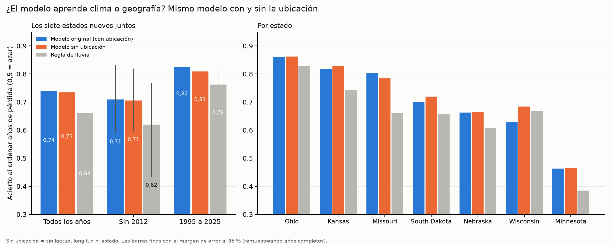
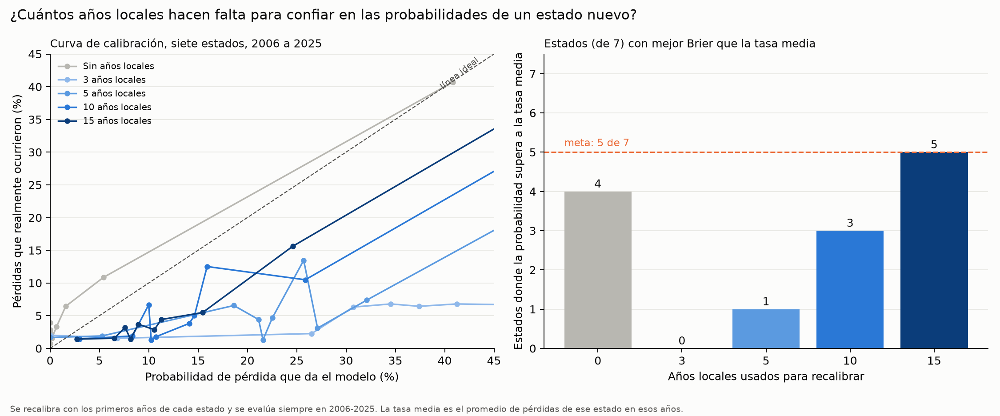
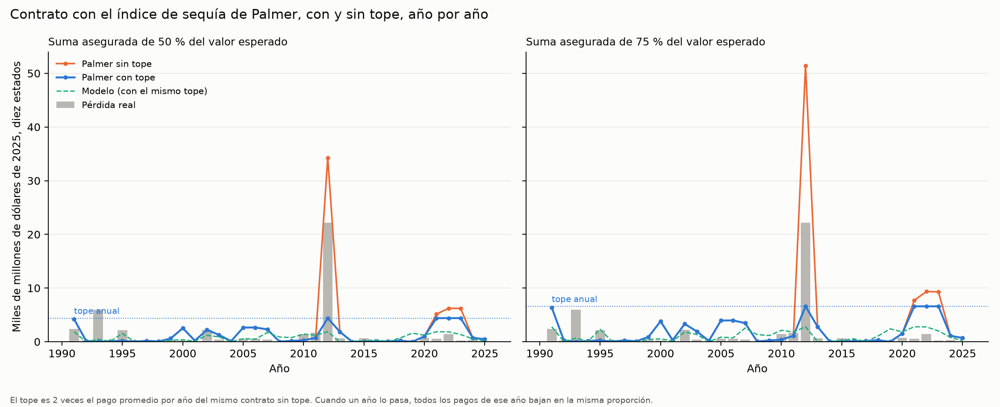
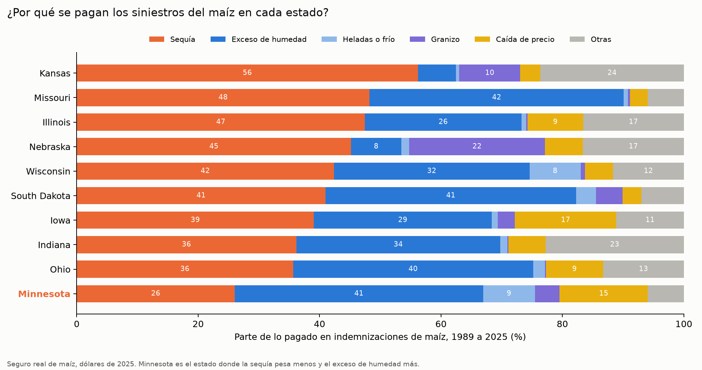
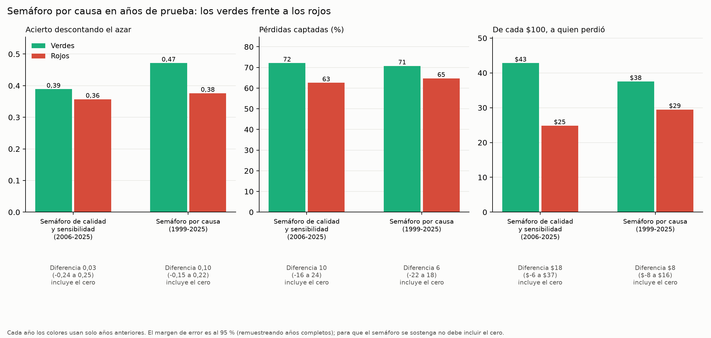
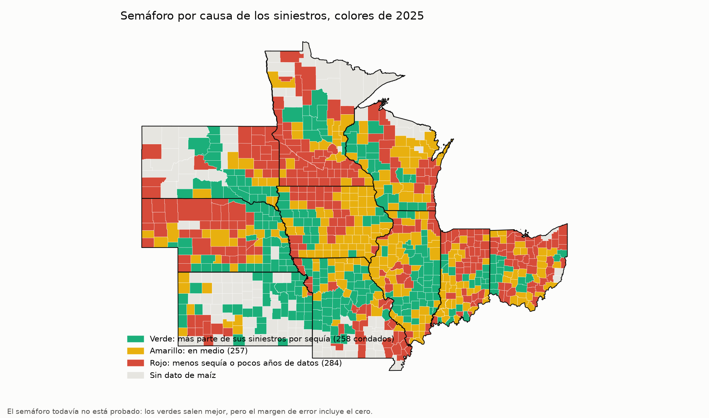

# Resultados del cierre: cuatro preguntas que dejó abiertas la prueba a ciegas

Plan congelado y subido a git antes de correr nada: `docs/plan_cierre.md` (commit "Plan congelado del cierre"). Scripts `40` a `45`. Todo es adicional: el modelo principal y sus resultados no se tocaron. Tablas: `datos/procesados/cierre_*.csv` y `cierre_*.json`. Figuras: `docs/figuras/pitch_cierre_*.png`.

## Conclusión en pocas frases

1. **El modelo aprende sobre todo clima, no geografía.** Sin latitud, longitud ni estado, el acierto baja solo de 0,739 a 0,734 (0,005). El criterio fijado (0,02 o menos) se cumple.
2. **Hacen falta 15 años locales** para que las probabilidades superen a la tasa media en al menos 5 de 7 estados. Con 3 y 5 años, recalibrar empeora las cosas. Es un resultado justo en el límite: con 10 años solo 3 estados lo logran.
3. **El contrato Palmer con topes no es "vendible"** según el criterio fijado. El tope arregla 2012, pero en 23 de 35 años el contrato paga más de 1,5 veces la pérdida real de ese año.
4. **Minnesota es el estado donde menos pesa la sequía** entre las causas de los siniestros (26 % frente a 36-56 % en los demás) y donde más pesa el exceso de humedad (41 %). Es una coincidencia con que el modelo de sequía le acierte menos; los datos no prueban que sea la causa.
5. **Ningún semáforo se sostiene.** El semáforo por causa también sale mejor en los verdes, pero el margen de error incluye el cero.

## Fase 1. ¿Clima o geografía?

Se repitió la prueba a ciegas principal con el mismo LightGBM, rejilla, calibración y corte de pago, quitando latitud, longitud y estado. Quedan 13 variables de clima: lluvia de mayo a septiembre, meses secos seguidos, falta de lluvia de julio y agosto, temperatura máxima de junio a agosto y Palmer de junio a agosto. La regla de lluvia reproduce exactamente la corrida original (comprobado en los tres originales).

Siete estados nuevos, acierto al ordenar (AUC) y Heidke:

| Versión | Modelo original | **Modelo sin ubicación** | Regla de lluvia |
|---|---:|---:|---:|
| Todos los años 1991-2025 | 0,739 (Heidke 0,318) | **0,734 (0,284)** | 0,659 (0,218) |
| Sin 2012 | 0,709 (0,267) | 0,705 (0,234) | 0,620 (0,161) |
| 1995-2025 | 0,824 (0,345) | 0,809 (0,309) | 0,762 (0,235) |
| Sin condados con más de 25 % de riego | 0,769 (0,384) | 0,762 (0,331) | 0,677 (0,242) |

Por estado (AUC original / sin ubicación / regla): Ohio 0,859 / 0,862 / 0,828; Kansas 0,817 / 0,828 / 0,743; Missouri 0,802 / 0,787 / 0,660; South Dakota 0,700 / 0,719 / 0,655; Nebraska 0,663 / 0,665 / 0,607; Wisconsin 0,628 / 0,684 / 0,667; Minnesota 0,463 / 0,464 / 0,385. El valor p del modelo sin ubicación es 0,001 en el conjunto.

Diferencia de AUC original menos sin ubicación (remuestreo pareado de años): **0,005 (95 %: −0,021 a 0,030)** en los siete estados; 0,004 sin 2012; 0,025 (−0,015 a 0,080) en los tres originales.

**Criterio fijado:** 0,005 ≤ 0,02, **se cumple: el modelo aprende sobre todo clima.** Dos matices: el Heidke baja más (0,318 a 0,284), así que el corte de pago sí pierde algo sin ubicación; y en los tres estados de entrenamiento la diferencia es de 0,025, justo por encima de 0,02 (pero con un intervalo que incluye el cero).

**Qué significa:** la debilidad que se anotó (latitud y longitud fuera del rango de entrenamiento) casi no importa: quitarlas deja el acierto igual. Lo que el modelo traslada de un estado a otro es lo que aprende del clima.

## Fase 2. ¿Cuántos años locales hacen falta?

Se recalibró con regresión isotónica por estado usando los primeros K años (desde 1991) y se evaluó siempre en 2006-2025. K = 0 usa la calibración de los tres estados originales.

Mejora del Brier frente a la tasa media del estado (positivo = mejor que la tasa media):

| Estado | 0 años | 3 años | 5 años | 10 años | 15 años |
|---|---:|---:|---:|---:|---:|
| Kansas | +14 % | −46 % | +1 % | +16 % | +20 % |
| Minnesota | 0 % | −671 % | −103 % | −20 % | −13 % |
| Missouri | +28 % | −9 % | −8 % | +15 % | +25 % |
| Nebraska | −34 % | −147 % | −139 % | −12 % | +5 % |
| Ohio | −24 % | −23 % | −6 % | −13 % | −31 % |
| South Dakota | +13 % | −80 % | −15 % | +2 % | +11 % |
| Wisconsin | +8 % | −283 % | −44 % | −4 % | +6 % |
| **Estados mejores que la tasa media (de 7)** | **4** | **0** | **1** | **3** | **5** |

Los siete estados juntos: Brier 0,0646 con 0 años, 0,1655 con 3, 0,0933 con 5, 0,0674 con 10 y 0,0629 con 15, frente a 0,0699 de la tasa media.

**Conclusión fijada: el menor K que cumple (5 de 7 estados) es 15.** Matices:
- Con pocos años (3 y 5) la recalibración empeora mucho: la regresión isotónica con tan pocas pérdidas da probabilidades de 0 o 1.
- Sin años locales, 4 de 7 estados ya superan a la tasa media en 2006-2025 (en la prueba de 1991-2025 el Brier calibrado era peor que la tasa media en conjunto, 0,094 frente a 0,092: los primeros años pesan).
- Ohio y Minnesota no mejoran con ningún K. Nebraska solo con 15 años, por poco (+5 %).
- La referencia (tasa media del propio estado en los años evaluados) es exigente porque ya conoce el futuro del estado.

**Qué significa:** para confiar en las probabilidades de un estado nuevo hacen falta unos 15 años de su propia historia, y aun así no en todos los estados. Lo que sí sirve desde el primer día es el orden entre condados.

## Fase 3. Contrato Palmer con topes

Diez estados, 1991-2025, dólares de 2025. Tope anual = 2 veces la prima pura anual del mismo contrato (misma suma); si un año se pasa, todos sus pagos bajan en la misma proporción. Pérdida real de 2012: $22.197 millones.

| Suma | Contrato | Pagos 1991-2025 | Pago en 2012 | Pérdida cubierta | De cada $100, a quien perdió | Prima pura (% de la suma) | Pago anual máximo / pérdida de ese año |
|---|---|---:|---:|---:|---:|---:|---:|
| 50 % | Palmer sin tope | $76.970 mill. | $34.289 mill. | 50 % | $38 | 9,4 % | 28,2 veces (2025) |
| 50 % | **Palmer con tope** | $42.704 mill. | $4.398 mill. | 18 % | $23 | 5,2 % | 28,2 veces (2025) |
| 50 % | Regla de lluvia con tope | $52.943 mill. | $5.200 mill. | 19 % | $20 | 6,5 % | 23,5 veces (2023) |
| 50 % | Modelo con tope | $25.414 mill. | $1.857 mill. | 13 % | $25 | 3,1 % | 13,6 veces (2008) |
| 75 % | Palmer sin tope | $115.454 mill. | $51.434 mill. | 56 % | $38 | 9,4 % | 42,3 veces (2025) |
| 75 % | **Palmer con tope** | $64.057 mill. | $6.597 mill. | 22 % | $23 | 5,2 % | 42,3 veces (2025) |
| 75 % | Regla de lluvia con tope | $79.414 mill. | $7.800 mill. | 24 % | $20 | 6,5 % | 35,2 veces (2023) |
| 75 % | Modelo con tope | $38.121 mill. | $2.785 mill. | 20 % | $25 | 3,1 % | 20,5 veces (2008) |

(En la tabla, "Modelo" es suma × severidad prevista cuando se activa el corte aplicable; con 100 % de suma, las cifras de referencia están en `cierre_palmer_topes_resumen.csv`.)

**Criterio "vendible" (fijado en el plan):**
1. En ningún año el pago supera 1,5 veces la pérdida real: **NO se cumple.** Con tope, el contrato paga más de 1,5 veces la pérdida en 18 años (suma 50 %) y 23 años (suma 75 %) de 35; el peor es 2025 (pago de $688 millones frente a una pérdida real de $16 millones). Además paga en 2009, un año sin pérdida real.
2. De cada $100 a quien perdió, al menos lo mismo que la regla de lluvia con tope: **sí se cumple** ($23 frente a $20; sin tope, la regla de lluvia da $32, pero con un pago mucho mayor).

**Veredicto: no es vendible.** Lo que hace el tope: el año 2012 pasa de pagar 1,5 a 3,1 veces la pérdida (según suma) a pagar 0,2 a 0,3 veces, y el tope solo se activa en 4 años (2012, 2021, 2022 y 2023). Lo que no hace: el exceso de pago se reparte en muchos años de pérdida chica. Además, el tope baja la parte de la pérdida que cubre (de 56 % a 22 % con suma de 75 %) porque recorta justo el año de mayor pérdida.

**Qué significa:** poner un techo protege al asegurador de un año extremo, pero no arregla que el contrato pague en años donde casi nadie perdió. Habría que rediseñar el pago (por ejemplo, un disparador más exigente), no solo ponerle tope.

## Fase 4A. Causas de los siniestros y Minnesota

Cause of Loss de la RMA, maíz, 1989-2025, diez estados, indemnizaciones por $72.060 millones (dólares de 2025). Grupos fijados en el plan; sequía es el código 11 (la definición que ya usaba `31`).

| Estado | Sequía | Exceso de humedad | Heladas o frío | Granizo | Caída de precio | Otras |
|---|---:|---:|---:|---:|---:|---:|
| **Minnesota** | **26 %** | **41 %** | 8,5 % | 4,1 % | 14,5 % | 5,9 % |
| Ohio | 36 % | 40 % | 1,9 % | 0,1 % | 9,4 % | 13,3 % |
| Indiana | 36 % | 34 % | 1,2 % | 0,2 % | 6,1 % | 22,8 % |
| Iowa | 39 % | 29 % | 1,0 % | 2,8 % | 16,7 % | 11,1 % |
| South Dakota | 41 % | 41 % | 3,2 % | 4,4 % | 3,1 % | 7,0 % |
| Wisconsin | 42 % | 32 % | 8,4 % | 0,7 % | 4,6 % | 11,7 % |
| Nebraska | 45 % | 8 % | 1,3 % | 22,4 % | 6,2 % | 16,6 % |
| Illinois | 48 % | 26 % | 0,8 % | 0,2 % | 9,1 % | 16,6 % |
| Missouri | 48 % | 42 % | 0,7 % | 0,4 % | 2,9 % | 5,9 % |
| Kansas | 56 % | 6 % | 0,6 % | 10,0 % | 3,3 % | 23,6 % |

**Minnesota frente a los demás:** tiene la parte de sequía más baja de los diez estados, la mayor parte en heladas o frío (junto con Wisconsin) y la parte de exceso de humedad más alta salvo Missouri y South Dakota. En los otros seis estados nuevos, la sequía es 45 % de los pagos.

**Años de falla del modelo en Minnesota** (al menos 10 % de condados con pérdida y el modelo captó menos de la mitad): 1992, 1993, 2007 y 2014. En los cuatro captó 0 % de las pérdidas. 1993 (96 % de los condados con pérdida) fue el año de la inundación. En esos años, la sequía fue 12,6 % de lo pagado, el exceso de humedad 43 %, heladas o frío 17 % y caída de precio 22 %; en los demás años de Minnesota, la sequía fue 30 %.

**Qué significa:** en Minnesota las pérdidas que paga el seguro real vienen menos de la sequía que en otros estados, y en los años en que el modelo falló, aún menos. Eso encaja con que un modelo de sequía no las vea. **Pero es una coincidencia que muestran los datos, no una causa demostrada:** no se probó que quitar esas causas haga mejorar al modelo, y la RMA registra lo que se paga, no todo lo que se pierde.

## Fase 4B. Semáforo por causa

Se calculó cada año, con los siniestros de años anteriores, la parte pagada por sequía por condado; verde para el tercio con más sequía, rojo para el tercio con menos, o dato dudoso, o menos de 10 años con siniestros. Prueba hacia adelante en los diez estados.

**Un hecho de diseño:** el filtro de calidad exige 25 años de datos, y eso solo se cumple desde 2006. En 1999-2005 todos los condados quedan en rojo. Por eso la prueba principal (1999-2025) y la comparación pareja (2006-2025) se parecen: los verdes solo existen desde 2006. No se cambió el filtro.

Verde menos rojo, con el modelo (margen de error de 95 % remuestreando años; para cumplir no debe incluir el cero):

| Semáforo | Acierto descontando el azar | Pérdidas captadas (puntos) | De cada $100, a quien perdió |
|---|---:|---:|---:|
| **De 36 (calidad y sensibilidad), 2006-2025** | +0,03 (−0,24 a +0,25) | +9,6 (−15,8 a +24,3) | +$18,0 (−$6,2 a +$36,9) |
| **Por causa, 1999-2025 (principal)** | +0,10 (−0,15 a +0,22) | +6,0 (−22,5 a +17,8) | +$8,1 (−$7,6 a +$16,3) |
| Por causa, 2006-2025 (mismos años que el de 36) | +0,11 (−0,002 a +0,18) | +2,2 (−9,5 a +14,6) | +$8,9 (+$0,9 a +$14,7) |

**Veredicto:** ninguno de los dos cumple el criterio. El semáforo por causa, en 2006-2025, excluye el cero solo en "de cada $100" (y casi en Heidke), pero no en pérdidas captadas. Los verdes salen mejor en las tres medidas en los dos semáforos, pero el margen de error incluye el cero. Con la prueba principal (la fijada), no cumple.

Los colores de 2025 por causa: 258 verdes, 257 amarillos y 284 rojos.

**Debilidad que se declaró de antemano:** pocos años con siniestros no es lo mismo que poco riesgo; un condado de bajo riesgo queda en rojo.

**Qué significa:** el semáforo todavía no está probado. Los verdes salen mejor, pero con 20 a 27 años de prueba el margen de error incluye el cero.

## Qué se puede decir y qué no

**Se puede decir:**
- El modelo aprende sobre todo clima: sin latitud, longitud ni estado, el acierto en siete estados que nunca vio casi no cambia (0,739 a 0,734) y sigue ganándole a la regla de lluvia (0,659).
- Para usar sus probabilidades como probabilidades en un estado nuevo se necesitan unos 15 años locales, y aun así no funcionó en todos los estados.
- Un contrato Palmer con tope evita pagar tres veces la pérdida en un año extremo como 2012.
- En Minnesota la sequía pesa menos entre las causas de los siniestros pagados (26 % frente a 36-56 % en los demás estados).

**No se puede decir:**
- Que el contrato Palmer con topes sea vendible: paga más de 1,5 veces la pérdida en 18 a 23 de 35 años.
- Que algún semáforo funcione.
- Que las causas expliquen por qué falla el modelo en Minnesota: es una coincidencia, no una causa demostrada.
- Que "15 años" sea una cifra exacta: depende de los estados y de la referencia usada, y con 10 años solo 3 de 7 estados mejoran.
- Que el modelo sirva sin recalibrar en un estado nuevo.

## Notas de la corrida

- `git pull` falló desde PowerShell (pidió credenciales) y funcionó desde Bash: "Already up to date".
- Todos los criterios se fijaron antes y no se cambiaron. El plan se escribió con la definición de sequía igual a la de `31` (código 11 solamente); calor y viento caliente quedaron en "otras".
- La Fase 1 tardó unos 35 minutos (el modelo sin ubicación y sus 1.000 + 1.000 barajadas por subconjunto).
