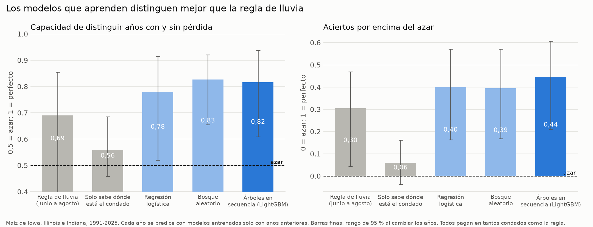
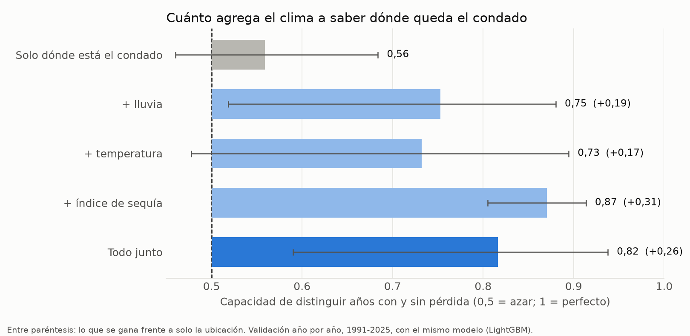
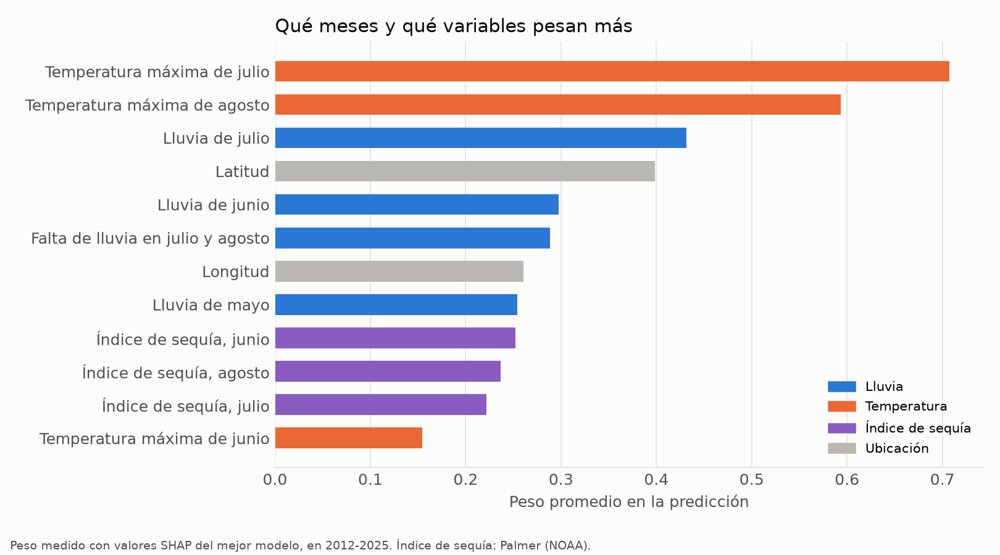
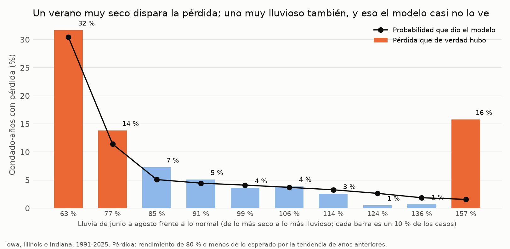
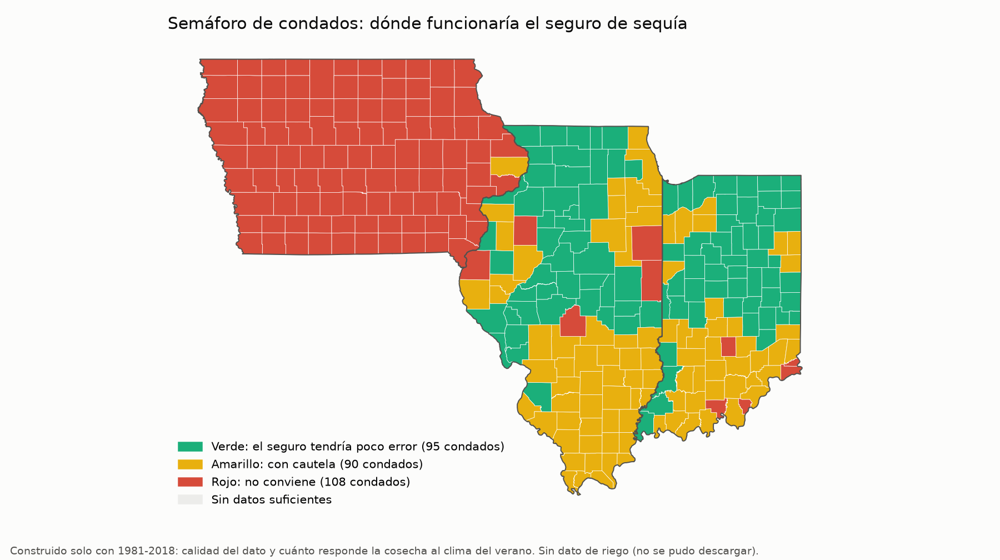
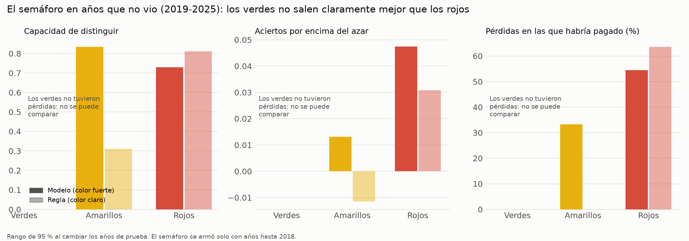

# Seguro de sequía para el maíz de EE. UU.: resultados del modelo

Plan, fijado antes de correr, y correcciones: `docs/bitacora.md`, 2026-11-04. Scripts: `27_adquisicion_eeuu.py` a `32_figuras_eeuu.py`. El impacto en dólares está en `docs/impacto_economico_eeuu.md`.

**Zona y datos:** Iowa, Illinois e Indiana, 293 condados y 12.544 condado-años (1981–2025). No se pudo extender al resto del cinturón maicero: no hay clave de NASS y su archivo masivo pesa 1,05 GB. Sin dato de riego: los censos de NASS respondieron 404.

**Advertencia de honestidad:** el control de EE. UU. ya se había mirado antes, así que esto no es una prueba a ciegas. Por eso todas las decisiones se tomaron con años hasta 2018, y la medida principal es la validación hacia adelante.

**Actualización (2026-11-05):** la prueba a ciegas con siete estados nuevos, con el modelo congelado de este documento, está en `docs/resultados_prueba_ciegas.md`. El modelo pasó (AUC 0,74 frente a 0,66 de la regla), y el semáforo de la sección 5 siguió sin sostenerse. Las cifras de abajo son las de Iowa, Illinois e Indiana y no cambian.

## Conclusión en cinco frases

1. **El modelo distingue mejor que la regla.** Año por año, sin ver el futuro, LightGBM logra un AUC de 0,82 frente a 0,69 de la regla de lluvia y 0,56 de un modelo que solo sabe dónde está el condado (azar = 0,5).
2. **El clima agrega mucho a la ubicación:** de 0,56 a 0,82 con todo, y a 0,87 con solo el índice de sequía de Palmer. La ubicación sola casi no anticipa las pérdidas.
3. **Lo que más pesa es el calor de julio y agosto y la lluvia de julio,** que coincide con la floración y el llenado del grano.
4. **Depende mucho de 2012:** sin 1988 ni 2012, el AUC baja a 0,70 y la regla a 0,60. El modelo sigue ganándole a la regla, pero con menos margen.
5. **El semáforo de condados no se sostiene.** En 2019–2025 los condados verdes no tuvieron ni una pérdida, así que no se puede mostrar que funcionen mejor que los rojos. No se presenta como herramienta.

## 1. Modelos contra la regla y contra el azar

**Validación hacia adelante, 1991–2025 (medida principal).** 9.614 condado-años y 818 pérdidas. Cada año *t*, la tendencia, la pérdida, los hiperparámetros y la calibración salen solo de años anteriores. Todos los modelos pagan en tantos condado-años como la regla. Los intervalos de 95 % salen de remuestrear años, y los valores p de barajar años completos.

| Modelo | AUC (IC 95 %) | Heidke (IC 95 %) | % de pérdidas captadas | % de alertas sin pérdida | Brier calibrado | Brier de la tasa media | Valor p del AUC |
|---|---:|---:|---:|---:|---:|---:|---:|
| Regla de lluvia (junio a agosto, p15) | 0,690 (0,38–0,85) | 0,304 (0,04–0,47) | 47,3 | 68,9 | – | 0,078 | 0,005 |
| Solo ubicación | 0,559 (0,46–0,69) | 0,059 (−0,04–0,16) | 19,6 | 87,1 | 0,085 | 0,078 | 0,641 |
| Regresión logística | 0,779 (0,52–0,92) | 0,399 (0,16–0,57) | 58,1 | 61,8 | 0,078 | 0,078 | 0,002 |
| Bosque aleatorio | 0,826 (0,65–0,92) | 0,395 (0,17–0,57) | 57,6 | 62,1 | 0,075 | 0,078 | 0,001 |
| **LightGBM (mejor en validación)** | **0,816 (0,61–0,94)** | **0,445 (0,21–0,61)** | **63,2** | **58,4** | **0,064** | 0,078 | 0,001 |

**Con y sin los años extremos (LightGBM frente a la regla):**

| Variante | AUC del modelo | AUC de la regla | Heidke del modelo | Heidke de la regla |
|---|---:|---:|---:|---:|
| Todos los años | 0,816 | 0,690 | 0,445 | 0,304 |
| Sin 2012 al evaluar | 0,757 | 0,598 | 0,336 | 0,193 |
| Sin 1988 ni 2012, ni al entrenar ni al evaluar | 0,702 | 0,598 | 0,275 | 0,193 |

**Partición fija (entrenamiento 1981–2011, validación 2012–2018, prueba 2019–2025).**
- Se escogió LightGBM por su AUC en validación (0,970, frente a 0,966 del bosque y 0,912 de la regresión logística).
- **En prueba solo hubo 14 pérdidas en 1.683 condado-años (0,8 %),** así que esta prueba tiene muy poca potencia.

| Modelo, prueba 2019–2025 | AUC (IC 95 %) | Heidke | Pérdidas captadas | Valor p del AUC |
|---|---:|---:|---:|---:|
| Regla | 0,744 (0,10–0,89) | 0,029 | 7 de 14 | 0,298 |
| Solo ubicación | 0,408 | −0,003 | 2 de 14 | 0,439 |
| Regresión logística | 0,902 (0,58–0,95) | 0,056 | 11 de 14 | 0,087 |
| Bosque aleatorio | 0,853 (0,75–0,90) | 0,049 | 10 de 14 | 0,017 |
| LightGBM | 0,777 (0,72–0,87) | 0,029 | 7 de 14 | 0,125 |
| LightGBM sin 1988 ni 2012 en entrenamiento | 0,861 | 0,042 | 9 de 14 | 0,008 |

**Lectura:**
- En 2019–2025 casi no hubo pérdidas, y por eso el Heidke es bajo para todos. El modelo elegido (LightGBM) no es el mejor en prueba: la regresión logística y el bosque le ganan.
- No se cambió el modelo después de ver la prueba.
- Lo más sólido es la validación hacia adelante, con 35 años y 818 pérdidas.

**Calibración (hacia adelante):**
- El Brier calibrado (0,064) es mejor que usar siempre la tasa media (0,078).
- **Las probabilidades no están bien calibradas en todos los tramos.** En el 10 % de casos con más riesgo, el modelo da 46 % y hubo 36 %. En el quinto decil da 0,2 % y hubo 9,6 %.
- En 2024 y 2025 no hubo con qué calibrar, porque 2021–2023 no tuvieron pérdidas, y se usó la probabilidad sin calibrar.
- Tabla: `eeuu_sequia_calibracion.csv`.

## 2. Cuánto agrega el clima a saber dónde queda el condado

AUC hacia adelante, 1991–2025:

| Variables | LightGBM | Regresión logística |
|---|---:|---:|
| Solo ubicación | 0,559 | 0,596 |
| Ubicación + lluvia | 0,753 (+0,19) | 0,690 (+0,09) |
| Ubicación + temperatura | 0,732 (+0,17) | 0,776 (+0,18) |
| Ubicación + índice de sequía de Palmer | **0,871 (+0,31)** | 0,714 (+0,12) |
| Todas | 0,816 (+0,26) | 0,779 (+0,18) |
| Todas menos lluvia | 0,783 | 0,776 |
| Todas menos temperatura | 0,807 | 0,683 |
| Todas menos Palmer | 0,783 | 0,780 |

**Lectura:**
- **La lluvia sola agrega entre 0,09 y 0,19 a la ubicación.** El índice de sequía de Palmer es lo que más agrega con LightGBM.
- **Más variables no siempre ayudan:** con LightGBM, solo ubicación y Palmer (0,871) supera a todas las variables juntas (0,816).
- Esto se ve en la validación hacia adelante, después de fijar el modelo. **No se cambió el modelo por esto**: escoger ahora el grupo de variables usando estos años sería usar el resultado para decidir.
- **Temperatura frente a lluvia:** en la regresión logística, la temperatura es lo que más pesa (quitarla baja el AUC de 0,78 a 0,68). En LightGBM, quitarla cambia poco (0,816 a 0,807), porque el Palmer y la lluvia ya cuentan casi lo mismo.

## 3. Qué meses y qué variables pesan

SHAP del LightGBM de la partición fija, en 2012–2025:

| Orden | Variable | Efecto |
|---:|---|---|
| 1 | Temperatura máxima de julio | Un julio más caliente que lo normal sube el riesgo |
| 2 | Temperatura máxima de agosto | Igual que julio |
| 3 | Lluvia de julio | Un julio más seco sube el riesgo |
| 4 | Latitud | – |
| 5 | Lluvia de junio | Más seco, más riesgo |
| 6 | Falta de lluvia en julio y agosto | Más falta, más riesgo |

**¿Coincide con junio a agosto?** Sí. Las primeras variables de clima son de julio y agosto, la floración y el llenado del grano, y luego junio.

**Dos efectos al revés de lo esperado:** un mayo más húmedo sube el riesgo, quizá por siembra tardía, y un junio más seco según Palmer lo baja. Son interpretaciones, no pruebas.

**Ojo con los veranos muy lluviosos:** en el 10 % de condado-años más lluviosos hubo 16 % de pérdidas, sobre todo por la inundación de 1993, y el modelo les dio 1,5 %. El seguro de sequía no cubre ese riesgo.

## 4. Severidad y pérdida esperada

| Medida, hacia adelante 1991–2025 | Modelo | Línea base |
|---|---:|---:|
| Error medio de la severidad, en las 818 pérdidas | 0,099 | 0,105 (severidad media de años anteriores) |
| Spearman de la severidad prevista con la real | 0,16 | – |
| Error medio de la pérdida esperada (probabilidad × severidad), en todos los condado-años | 0,032 | 0,068 (tasa histórica × severidad media) |
| Spearman de la pérdida esperada con el faltante real | 0,34 | – |

**Lectura:** el tamaño de la pérdida casi no se anticipa: el error baja apenas de 0,105 a 0,099. La pérdida esperada sí mejora mucho a la línea base, gracias a la probabilidad y no a la severidad.

## 5. Semáforo de condados

**Construcción, solo con años ≤ 2018:**
- Calidad del dato: al menos 25 años válidos, a lo sumo 5 % de repetidos y sin salto de área.
- Sensibilidad del rendimiento al índice de estrés del verano, con pendientes encogidas hacia la media del estado (peso medio del condado: 0,28).
- Sin la condición de riego, porque no se pudo bajar el dato.

**Resultado:**

| Color | Condados | Iowa | Illinois | Indiana |
|---|---:|---:|---:|---:|
| Verde | 95 | 0 | 45 | 50 |
| Amarillo | 90 | 1 | 52 | 37 |
| Rojo | 108 | 98 | 5 | 5 |

**¿Por qué Iowa sale casi todo rojo?**
- No es un error de datos. Antes de 2018, la peor pérdida de Iowa fue la inundación de 1993: un verano muy lluvioso y fresco, con 59 % de lo esperado.
- Una relación lineal con el estrés de sequía queda casi plana: con todos los años, la correlación anual de Iowa entre rendimiento y lluvia de junio a agosto es 0,01; sin 1993, 0,39.
- Es una lectura hecha después de ver el resultado. La regla no se cambió.

**Prueba en 2019–2025 (partición fija):**

| Color | Condado-años | Pérdidas | AUC del modelo | Heidke del modelo | Pérdidas captadas |
|---|---:|---:|---:|---:|---:|
| Verde | 563 | **0** | – | 0,000 | – |
| Amarillo | 481 | 3 | 0,835 | 0,013 | 1 de 3 |
| Rojo | 639 | 11 | 0,729 | 0,047 | 6 de 11 |

**El criterio fijado no se cumple:** la diferencia verde − rojo en AUC no se puede calcular, y en Heidke es negativa (−0,047). **El semáforo no se sostiene** y no se presenta como herramienta.

**Qué significa:**
- La prueba no dice que el semáforo esté al revés. Dice que con 14 pérdidas en 7 años, y ninguna en los verdes, no hay cómo probarlo.
- La comparación por color en 1991–2025 sí existe en `eeuu_impacto_simulacion.csv`, pero usa años con los que se armó el semáforo, así que es descriptiva y no prueba nada.

## 6. Registro en MLflow

- **Experimento:** `seguro_sequia_maiz_eeuu`.
- **Modelo registrado:** `perdida_maiz_eeuu`, LightGBM con 31 hojas y hoja mínima 50, alias `mejor_en_validacion`.
- **Para verlo:** `mlflow ui --backend-store-uri sqlite:///mlflow.db`.

## Cómo leer las métricas

- **AUC (capacidad de distinguir):** 0,5 es azar y 1 es perfecto.
- **Heidke (aciertos por encima del azar):** 0 es azar y 1 es perfecto.
- **Brier:** entre más bajo, mejor.
- **Pérdida:** rendimiento de 80 % o menos del esperado por la tendencia del condado, medido con NASS. No es la pérdida en cada finca.
