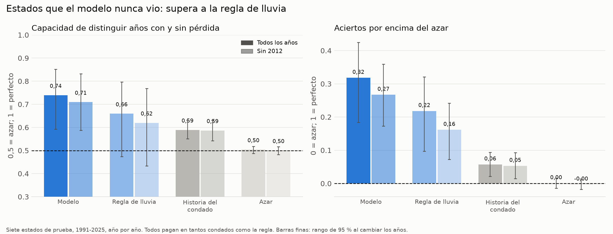
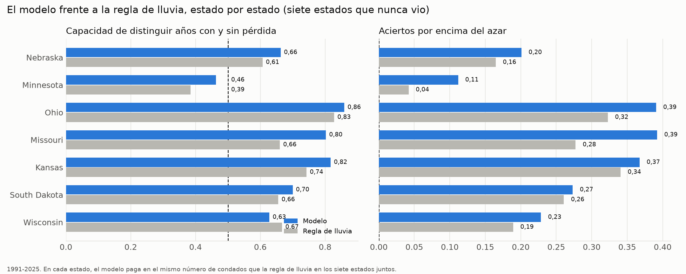
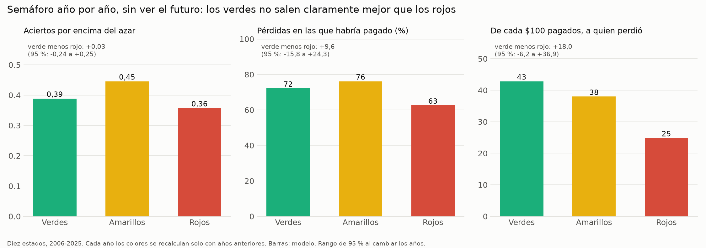
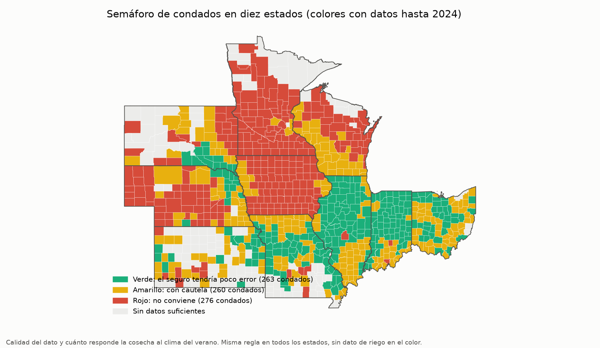
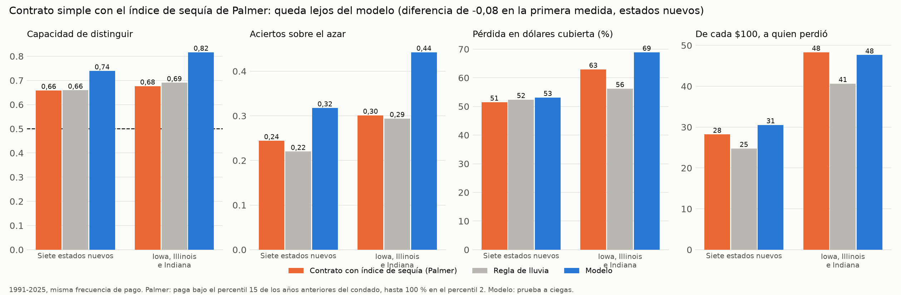

# Prueba a ciegas del seguro de sequía para el maíz de EE. UU.

Plan congelado y subido a git antes de mirar los estados nuevos: `docs/plan_prueba_ciegas.md` (commit "Plan congelado de la prueba a ciegas"). Scripts: `33` a `39`. Dólares: `docs/impacto_economico_eeuu.md`. Registro en MLflow: experimento `seguro_sequia_maiz_eeuu`, corridas `prueba_ciegas|...` y `contrato_palmer|...`.

## Conclusión en pocas frases

1. **El modelo pasó la prueba a ciegas.** En siete estados que nunca vio (Nebraska, Minnesota, Ohio, Missouri, Kansas, South Dakota y Wisconsin), distingue los años con pérdida mejor que la regla de lluvia: 0,74 frente a 0,66, con los tres criterios fijados de antemano cumplidos.
2. **Pero no gana en todos los estados.** En Minnesota no distingue mejor que el azar, y en Wisconsin pierde contra la regla. Y sus probabilidades, sin calibrar con datos locales, no mejoran la tasa media (Brier 0,094 frente a 0,092).
3. **El semáforo no se sostiene,** ni año por año ni de un estado a otro. Los verdes salen mejor en la estimación, pero con tan pocos años el margen de error incluye el cero.
4. **El contrato simple con el índice de Palmer queda lejos del modelo** (0,08 de diferencia en la primera medida, y el umbral era 0,03). Aun así, es tan bueno como la regla de lluvia y se puede escribir en un contrato.
5. **Plata:** en los diez estados, de cada $100 que paga el índice con el modelo llegan $34 a condados que perdieron (azar: $10). **Corrección del 2026-11-08:** antes se decía "igual que con el seguro real"; esa comparación no es válida, porque el seguro real paga por finca y por otras causas. El costo del índice es un supuesto.

## 1. Datos de los estados nuevos

| Estado | Condados en la base | Condado-años | Condados con salto de área (excluidos) | Rendimientos repetidos |
|---|---:|---:|---:|---:|
| Nebraska | 90 | 3.751 | 1 | 3 |
| Minnesota | 74 | 3.102 | 6 | 41 |
| Ohio | 84 | 3.617 | 2 | 4 |
| Missouri | 89 | 3.439 | 9 | 4 |
| Kansas | 54 | 2.123 | **51 de 105** | 4 |
| South Dakota | 50 | 2.034 | 15 | 12 |
| Wisconsin | 65 | 2.801 | 0 | 5 |
| **Total** | **506** | **20.867** | | 73 de 24.341 (0,3 %) |

- Con los tres estados originales, la base tiene 33.411 condado-años en 799 condados.
- **Kansas:** el filtro de salto de área (cambio de nivel de 5 veces o más) sacó a la mitad de sus condados. Es el mismo filtro de siempre; no se cambió. Se anota porque Kansas queda con menos peso.
- **Validación del código:** aplicado a Iowa, Illinois e Indiana, el código nuevo reproduce las variables de la base original con diferencia máxima 0, y las predicciones del modelo (9.614 filas) coinciden con la corrida anterior con diferencia 0.
- **Fuentes (anotadas en `registro_descargas.csv`):** NASS por API (encuesta, 1981-2025: rendimiento, producción, área cosechada y área sembrada; censos 1997-2022 de área con riego), CHIRPS (recuadro de 6 MB por año, unos 280 MB en total, bajo el límite de 500 MB), temperatura máxima y Palmer de NOAA, y RMA. La RMA incluye los siete estados.
- **Descartado por tamaño:** nada. No hizo falta recortar estados.

## 2. Prueba a ciegas del modelo

**Cómo se hizo.** Cada año *t* de 1991 a 2025, el modelo (LightGBM, mismas variables, mismos hiperparámetros, calibración y corte de pago de `29_modelos_eeuu.py`) se entrena solo con Iowa, Illinois e Indiana en años anteriores a *t*, y predice los siete estados nuevos. Los estados nuevos no se usan para entrenar, escoger ni calibrar. Todos los comparadores pagan en tantos condado-años como la regla de lluvia (2.416 de 15.838).

**Base de la prueba:** 15.838 condado-años y 1.622 pérdidas (10,2 %) en los siete estados.

### Resultado principal, todos los años 1991-2025

| | AUC (95 %) | Heidke (95 %) | Pérdidas captadas | Alertas sin pérdida | Valor p del AUC |
|---|---:|---:|---:|---:|---:|
| **Modelo** | **0,739 (0,59-0,85)** | **0,318 (0,18-0,43)** | 50,0 % | 66,4 % | 0,001 |
| Regla de lluvia | 0,659 (0,47-0,80) | 0,218 (0,10-0,32) | 39,1 % | 73,8 % | 0,001 |
| Historia de pérdidas de cada condado | 0,589 (0,55-0,63) | 0,057 (0,02-0,09) | 21,5 % | 85,6 % | 1,000 |
| Azar | 0,504 | 0,001 | 15,4 % | 89,7 % | 0,249 |

### Criterio de éxito fijado en el plan

| Criterio | Resultado | ¿Se cumple? |
|---|---|---|
| AUC del modelo al menos 0,05 mayor que el de la regla | 0,739 − 0,659 = **+0,080** | Sí |
| Heidke del modelo mayor que el de la regla | 0,318 frente a 0,218 | Sí |
| Valor p del AUC del modelo (barajando años completos) menor de 0,05 | 0,001 | Sí |

**El modelo pasa la prueba a ciegas.** Lo que esto significa: lo aprendido en Iowa, Illinois e Indiana se traslada a otros estados del cinturón maicero con un poco menos de fuerza (0,82 en los tres originales, 0,74 en los nuevos), y sigue ganándole a la regla de lluvia. Lo que no significa: que sirva en cualquier lugar, ni que sus probabilidades estén bien calibradas allá.

### Versiones de contexto (no cambian el veredicto)

| Versión | AUC modelo | AUC regla | Heidke modelo | Heidke regla |
|---|---:|---:|---:|---:|
| Todos los años | 0,739 | 0,659 | 0,318 | 0,218 |
| **Sin 2012** | 0,709 | 0,620 | 0,267 | 0,161 |
| 1995-2025 (sin la superposición con la ventana de lo normal) | 0,824 | 0,762 | 0,345 | 0,235 |
| **Sin condados con más de 25 % de riego** (3.775 condado-años menos) | 0,769 | 0,677 | 0,384 | 0,242 |
| Variante secundaria (entrena también con los años anteriores de los estados nuevos) | 0,745 | 0,659 | 0,304 | 0,218 |

- **2012 pesa menos que en los tres estados originales:** sin 2012 el modelo baja de 0,74 a 0,71 (en los originales bajaba de 0,82 a 0,76).
- **El riego no explica el resultado:** quitando los condados con mucho riego, el modelo mejora.
- **La variante secundaria casi no cambia el AUC** (0,745) pero **sí mejora la calibración:** Brier 0,084 frente a 0,092 de la tasa media. Con datos locales de los estados nuevos, las probabilidades se vuelven útiles.

### Por estado (siete estados nuevos, todos los años)

| Estado | Pérdidas | AUC modelo | AUC regla | Heidke modelo | Heidke regla | Valor p del modelo |
|---|---:|---:|---:|---:|---:|---:|
| Ohio | 260 | 0,859 | 0,828 | 0,391 | 0,323 | 0,001 |
| Kansas | 241 | 0,817 | 0,743 | 0,367 | 0,341 | 0,001 |
| Missouri | 425 | 0,802 | 0,660 | 0,392 | 0,277 | 0,001 |
| South Dakota | 206 | 0,700 | 0,655 | 0,273 | 0,261 | 0,005 |
| Nebraska | 204 | 0,663 | 0,607 | 0,201 | 0,165 | 0,020 |
| Wisconsin | 120 | 0,628 | 0,667 | 0,228 | 0,189 | 0,036 |
| **Minnesota** | 166 | **0,463** | 0,385 | 0,112 | 0,042 | 0,619 |

- **Gana en 6 de 7 estados en AUC y en Heidke en los 7.** Ohio, Kansas y Missouri son los mejores.
- **Minnesota:** el modelo no distingue mejor que el azar (0,46), y la regla tampoco (0,39). Algo de ese estado no lo captan ni la lluvia ni el modelo. Sin 2012 es igual (0,47). No se investigó la causa; sería una hipótesis, por ejemplo suelos fríos o drenaje, y no se afirma.
- **Wisconsin:** el modelo tiene mejor Heidke pero menor AUC que la regla, y sin 2012 baja a 0,54.
- **Nebraska** sin 2012 tiene valor p de 0,081.

### Calibración, dicho sin adornos

En la prueba principal el Brier calibrado del modelo es **0,094, peor que la tasa media de 0,092**. El modelo ordena bien los condado-años por riesgo, pero sus probabilidades, calibradas con otros estados, no son confiables en estos. No se debe leer "30 %" como 30 % de pérdidas reales en un estado nuevo sin recalibrar. La variante secundaria sí queda mejor que la tasa media.

## 3. Semáforo, ahora con pérdidas

**Por qué falló la primera prueba (2026-11-04).** En la partición fija 2019-2025 solo hubo 14 pérdidas en 1.683 condado-años, y los condados verdes no tuvieron ni una; no había con qué comparar. Además, Iowa quedó casi todo rojo porque la inundación de 1993 borra la relación lineal con la sequía. No se escondió: el semáforo no se presentó como herramienta.

**Qué se hizo ahora.** La misma regla congelada de colores (dato bueno, sensibilidad con encogimiento de Bayes por estado y terciles; verde, amarillo, rojo), con riego en una variante. En la prueba 1 los colores se recalculan cada año solo con años anteriores, incluidos el salto de área y la tendencia. Esto da 20 años evaluados (2006-2025) con 13.675 condado-años y 985 pérdidas.

### Prueba 1: año por año, diez estados (2006-2025), modelo

| Color | Condados | Condado-años | Pérdidas | AUC | Heidke | Pérdidas captadas | De cada $100, a quien perdió |
|---|---:|---:|---:|---:|---:|---:|---:|
| Verde | 335 | 4.526 | 323 | 0,901 | 0,389 | 72,1 % | $43 |
| Amarillo | 383 | 4.274 | 344 | 0,891 | 0,446 | 76,2 % | $38 |
| Rojo | 357 | 4.875 | 318 | 0,822 | 0,357 | 62,6 % | $25 |

| Diferencia verde − rojo | Valor | 95 % (remuestreo de años) | ¿Excluye el cero? |
|---|---:|---|---|
| Heidke | +0,03 | −0,24 a +0,25 | No |
| % de pérdidas captadas | +9,6 | −15,8 a +24,3 | No |
| De cada $100 a quien perdió | +$18,0 | −$6,2 a +$36,9 | No |
| (AUC, no es parte del criterio) | +0,08 | −0,03 a +0,15 | No |

### Prueba 2: colores de los estados nuevos hasta 2018, evaluados en 2019-2025 (2.710 condado-años, 166 pérdidas)

| Diferencia verde − rojo | Valor | 95 % | ¿Excluye el cero? |
|---|---:|---|---|
| Heidke | +0,01 | −0,20 a +0,25 | No |
| % de pérdidas captadas | **−13,1** | −61,2 a +26,5 | No (y sale negativa) |
| De cada $100 a quien perdió | +$10,1 | −$8,3 a +$29,7 | No |

### Veredicto y lectura

- **El criterio no se cumple en ninguna de las dos pruebas ni en ninguna variante** (la variante con riego tampoco; tampoco con solo los siete estados nuevos). El semáforo **no se sostiene** y no se presenta como herramienta.
- **Pero no está al revés.** En la prueba 1 los verdes salen mejor en las tres medidas (en AUC, la diferencia es +0,08), y en "de cada $100" por una distancia grande ($43 contra $25). Lo que falta es poder estadístico: son solo 20 años, y las pérdidas de un año se mueven juntas, así que el margen de error por años completos es amplio. Con solo los siete estados nuevos, la diferencia de AUC sí excluye el cero (+0,13; 0,01 a 0,21), pero ese no es el criterio.
- **La regla de colores sí cambia con los años:** de 244 verdes en 2006 a 263 en 2025.
- **El riego (variante) no ayuda de forma clara:** deja 312 verdes y 403 rojos, con diferencias similares.

## 4. Contrato simple con el índice de Palmer

**Contrato:** paga cuando el Palmer promedio de julio y agosto queda bajo el percentil 15 de los años anteriores del condado; el pago crece en línea recta hasta el 100 % de la suma asegurada en el percentil 2. La regla de lluvia usa la misma fórmula. Misma frecuencia de pago: 15,4 % de los condado-años en los estados nuevos.

| Conjunto | Índice | AUC | Heidke | Pérdida en dólares cubierta | De cada $100, a quien perdió | Pagos |
|---|---|---:|---:|---:|---:|---:|
| **Siete estados nuevos** | Palmer | 0,658 | 0,244 | 51,5 % | $28 | $79.090 millones |
| | Regla de lluvia | 0,659 | 0,220 | 52,4 % | $25 | $96.820 millones |
| | **Modelo** | **0,739** | **0,318** | 53,1 % | $31 | $39.980 millones |
| **Iowa, Illinois e Indiana** | Palmer | 0,677 | 0,301 | 63,0 % | $48 | $74.850 millones |
| | Regla de lluvia | 0,690 | 0,294 | 56,2 % | $41 | $85.170 millones |
| | **Modelo** | **0,816** | **0,442** | 68,9 % | $48 | $45.970 millones |
| **Diez estados** | Palmer | 0,666 | 0,265 | 58,0 % | $38 | $153.940 millones |
| | Regla de lluvia | 0,670 | 0,243 | 54,5 % | $32 | $181.990 millones |
| | Modelo | 0,765 | 0,362 | 62,0 % | $40 | $85.930 millones |

(Los pagos del modelo en esta tabla son con corte de igual frecuencia que el Palmer; en `impacto_economico_eeuu.md` se usa el corte aplicable.)

**Diferencia de AUC, Palmer menos modelo:** −0,081 en los estados nuevos (95 %: −0,136 a −0,026), −0,140 en los tres originales y −0,100 en los diez.

**Interpretación fijada en el plan:** el Palmer queda a más de 0,03 del modelo en todos los conjuntos. Entonces **el modelo aporta algo que el contrato simple no captura**.

**Pero:**
- El Palmer **iguala a la regla de lluvia** en lo que distingue (0,658 frente a 0,659) y la supera un poco en Heidke y en "de cada $100 a quien perdió" (cubre casi lo mismo de la pérdida en dólares). Es un contrato simple, público y verificable: sirve como piso para saber si un modelo más complejo vale la pena.
- **El pago proporcional paga muchísimo en un año extremo.** En 2012 habría pagado $68.600 millones en los diez estados, frente a una pérdida real de $22.200 millones y $15.000 millones de indemnización real. Porque la sequía de 2012 puso a casi todos los condados bajo el percentil 2 y la suma asegurada es el 100 % del valor esperado. Cualquier contrato así necesita topes y una suma asegurada menor.
- Cubrir más dólares con el Palmer es en parte pagar más: sus pagos son casi el doble que los del modelo con severidad.

## 5. Lo que se puede decir y lo que no

**Se puede decir:**
- Un modelo entrenado en tres estados distingue años de pérdida en otros siete mejor que la regla de lluvia, en 6 de 7 estados, y el resultado se mantiene sin 2012 y sin los condados con mucho riego.
- Un contrato simple con el Palmer se comporta como la regla de lluvia, y el modelo lo supera por unos 0,08 de AUC.

**No se puede decir:**
- Que el semáforo funcione: no cumplió el criterio.
- Que el modelo esté calibrado en estados nuevos: no lo está (Brier peor que la tasa media), salvo si se recalibra con datos locales.
- Que funcione en Minnesota.
- Que esto valga para otros países o cultivos: no se probó.
- Que el índice reemplace al seguro real: el seguro real cubre precio, exceso de lluvia y otras causas, y paga por finca.

## 6. Decisiones y problemas durante la corrida

- **Corrida en paralelo:** la primera vez, los procesos en paralelo se quedaron sin memoria (OpenBLAS pidió hilos de más). Se limitó a 1 hilo por proceso y 6 procesos, y se repitió la corrida completa. No cambia ningún resultado.
- **Desempate de la historia del condado:** muchos condados tienen tasa 0, y se desempata al azar con una semilla fija, para que el orden de los datos no favorezca a nadie.
- **Semáforo hacia adelante:** el salto de área, que en `30` se calculaba con todos los años, aquí se calcula solo con años anteriores. Es más estricto que el original.
- **Corte de riego de 25 %:** se calcula con el promedio de los censos 1997-2022. Un condado sin dato de censo se deja dentro (se asume sin riego alto).
- **Ubicación fuera del rango de entrenamiento:** el modelo usa latitud y longitud, que en los estados nuevos quedan fuera del rango de Iowa, Illinois e Indiana. Los árboles tratan esos valores como los más cercanos. No se cambió (el plan lo congeló), pero es una debilidad y una prueba pendiente.
